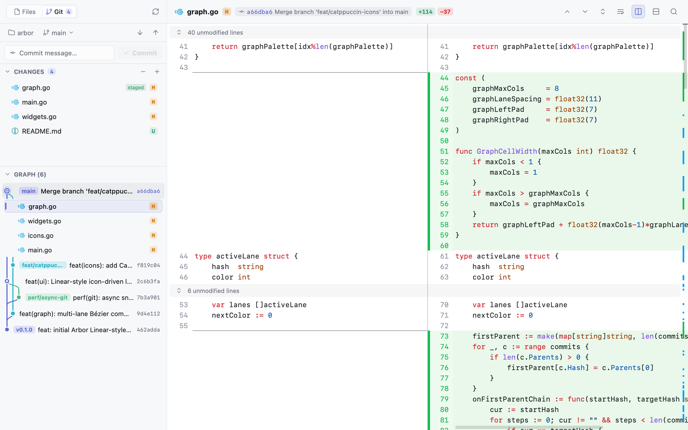
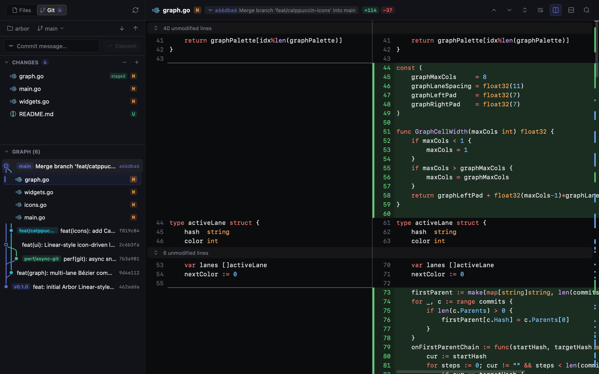
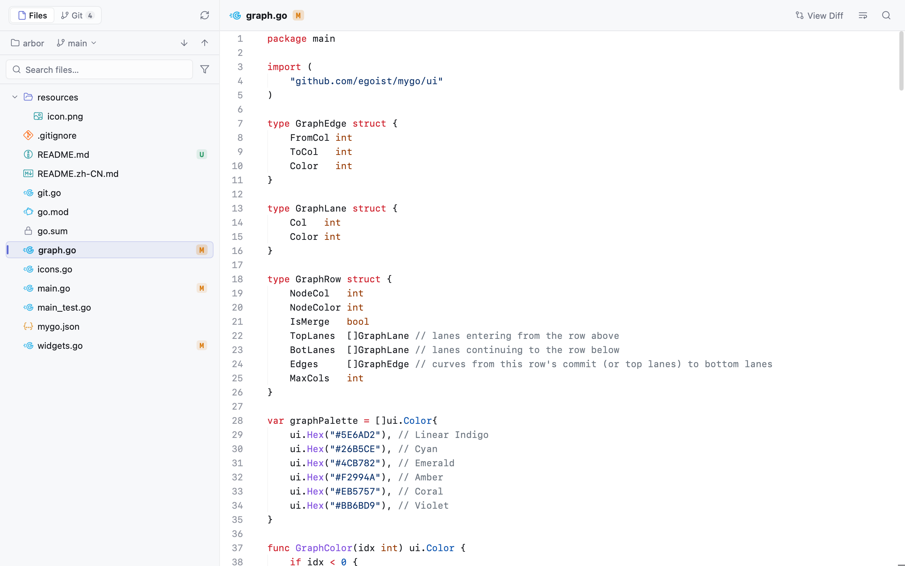
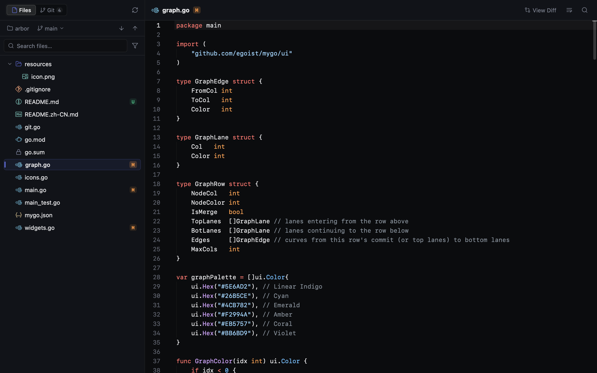

<div align="center">
  
  <h1>Arbor</h1>
  <p><b>A native, Linear-inspired Git client & workspace inspector built in Go.</b></p>
  <p>English · <a href="README.zh-CN.md">简体中文</a></p>
</div>

<br />

<picture>
  <source media="(prefers-color-scheme: dark)" srcset="docs/screenshots/git-dark.png">
  
</picture>

## Interface Showcase

| Git View (Light) | Git View (Dark) |
| :---: | :---: |
|  |  |
| **Files View (Light)** | **Files View (Dark)** |
|  |  |

## Highlights

- **Tactile Linear UI** — Spring-physics micro-interactions, borderless icon controls, Catppuccin language icons, and seamless Light & Dark themes.
- **Visual Commit Graph** — Multi-lane Bézier commit topology with inline commit file expansion, interactive staging, and quick commits.
- **Split & Unified Diffs** — Instant side-by-side and unified diff switching with syntax highlighting and collapsible unchanged regions.
- **Native & Instant** — Built in pure Go on top of GPU-accelerated [`mygo`](https://github.com/egoist/mygo), with zero Electron overhead and non-blocking async Git operations.

## Quick Start

```bash
# Run directly from source
go run ./cmd/arbor

# Or package a native desktop app bundle
mygo build
```

## License

MIT

## Project layout

```text
cmd/arbor/        the desktop app's entry point
cmd/arbor-perf/   performance tooling (see docs/perf-climb.md)
internal/app/     the interface: windows, views, live refresh, settings
internal/git/     Git commands, parsing and the commit graph layout
perf/             performance spans, budgets and the ledger
internal/perf*/   performance logs, aggregates and reports
internal/fixture/ the repositories benchmarks run on
e2e/              scenarios that drive the real app
resources/        icons and other bundled files
```
