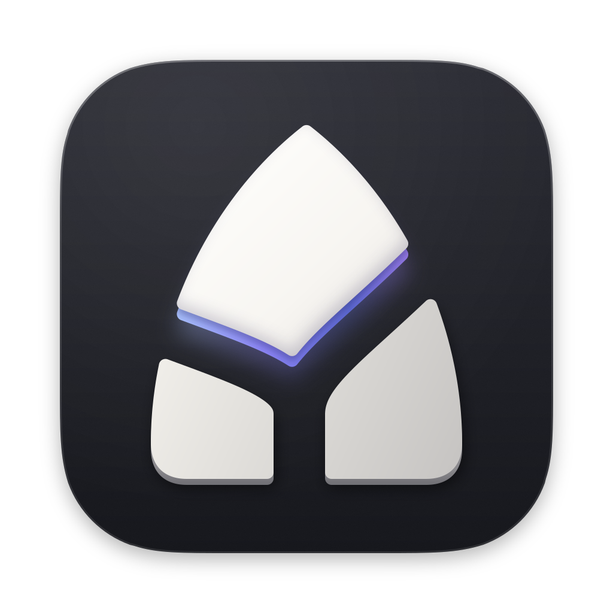
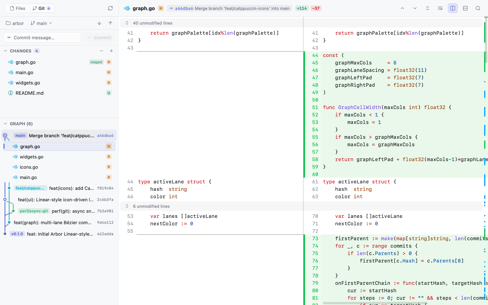
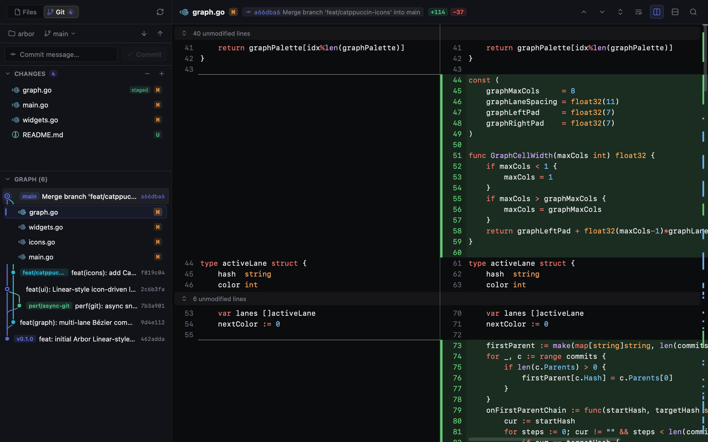
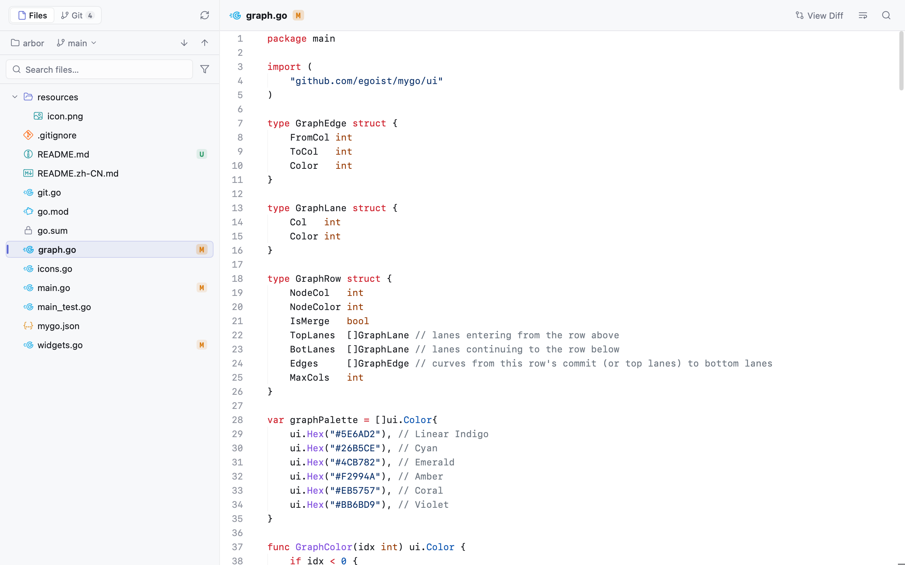
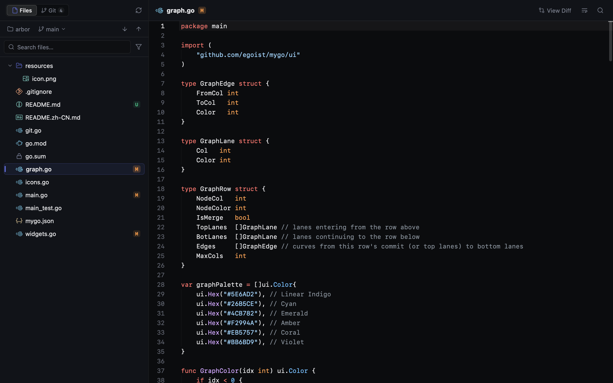

<div align="center">
  
  <h1>Arbor</h1>
  <p><b>基于 Go 构建的原生、Linear 风格 Git 客户端与工作区浏览器。</b></p>
  <p><a href="README.md">English</a> · 简体中文</p>
</div>

<br />

<picture>
  <source media="(prefers-color-scheme: dark)" srcset="docs/screenshots/git-dark.png">
  
</picture>

## 界面预览

| Git 视图（浅色） | Git 视图（深色） |
| :---: | :---: |
|  |  |
| **Files 视图（浅色）** | **Files 视图（深色）** |
|  |  |

## 核心特性

- **精致的 Linear 级交互** — 弹簧物理微动效、无边框图标按钮、Catppuccin 语言与文件图标，支持浅色与深色主题。
- **多泳道可视化提交图** — 平滑的多分支贝塞尔提交拓扑图，支持内联展开历史提交文件、暂存/取消暂存（Stage/Unstage）与快速提交。
- **双模式语法高亮 Diff** — 支持并排（Split）与统一（Unified）对比视图一键切换，具备多语言词法高亮与未改动行折叠。
- **纯原生极速体验** — 基于纯 Go 与 [`mygo`](https://github.com/egoist/mygo) GPU 加速渲染，彻底告别 Electron 内存开销，异步加载大型仓库依然流畅。

## 快速开始

```bash
# 直接从源码运行
go run ./cmd/arbor

# 或使用 mygo 打包原生桌面应用
mygo build
```

## 开源协议

MIT

## 项目结构

```text
cmd/arbor/        桌面应用入口
cmd/arbor-perf/   性能工具（见 docs/perf-climb.md）
internal/app/     界面：窗口、视图、实时刷新、设置
internal/git/     Git 命令、解析和提交图布局
perf/             性能埋点、预算和账本
internal/perf*/   性能日志、聚合和报告
internal/fixture/ 基准测试用的仓库
e2e/              驱动真实应用的场景测试
resources/        图标等打包资源
```
